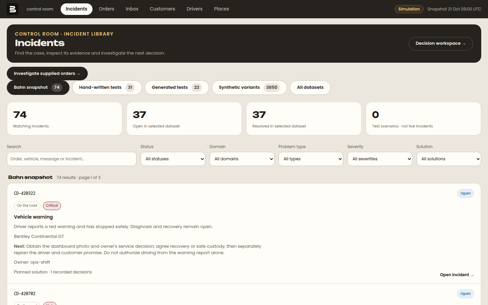

# Car Delivery Control Room — team Aalright

Our entry to Bahn's challenge at the Prompt Operations Hackathon (24–25 October 2026). The challenge
itself is in [`PARTICIPANT-BRIEF.md`](PARTICIPANT-BRIEF.md) and [`OPERATIONS-CONTEXT.md`](OPERATIONS-CONTEXT.md).



## What it is

**A control room that shows a person only the cases that need them, and one real agent for one area:
on the road, specifically a driver at risk of missing a booked ferry.**

- **Incident library** (`/incidents`): every incident from the Bahn snapshot, the hand-written and generated
  tests and the synthetic variants, with search and filters by status, domain, problem type, severity and
  solution.
- **Decision workspace** (`/incidents?view=workspace`): queues by status (*Decisions needed*, *Waiting for
  information*, *Investigating*, *Solved by the agent*…). Each case says what happened, what the agent already
  found out (with the source and time of every fact), and the one decision that is waiting.
- **The agent** is a real language model in a tool loop (Groq `openai/gpt-oss-120b` or Gemini). It does the
  cheap work first: it reads the order, asks the driver for an ETA, checks safety and blockers, looks up
  live weather, road works and trains, checks the booked ferry against the ETA, and searches alternative
  sailings. Then it either closes the case ("checked, no action needed") or prepares **one versioned
  proposal** for a person.
- **Approvals first.** The agent never books, pays, changes a date or contacts a customer. A person
  approves one exact proposal version; applying the change is a separate step; repeating it returns the
  same receipt. A changed proposal needs a new approval.
- **Driver Support** (`/driver`, mobile): a driver reports a problem, the agent starts at once, and the
  driver answers by text or by a clearly labelled SIMULATED call (typed, no phone network). The operator sees it live.
- **Honest labels.** Every result is labelled *REAL* (live weather, Autobahn, Digitraffic, OpenSky) or
  *SIMULATED* (driver replies, ferries, quotes, bookings). A missing model key shows a clear message; it never
  falls back to fake reasoning. A source that fails is shown as unavailable.
- **All 100 supplied orders** are browsable at `/incidents/orders`. Six orders have a future booked ferry and
  are in scope; for everything else the agent hands the case to a human with the reason.

Everything is fictional: no real people, messages, purchases or bookings.

## Run it from a fresh clone

You need Node.js 24+, Docker and (for the agent) a free [Groq](https://console.groq.com) or Gemini API key.

```sh
git clone https://github.com/olivierFer3/car-delivery-control-room.git
cd car-delivery-control-room/starter
cp .env.example .env
```

Edit `starter/.env`. `.env` is git-ignored: never commit it and never put real keys in `.env.example`.

**Required**

```sh
INCIDENT_OPERATOR_TOKEN=any-long-random-string   # the operator "password" in the UI; e.g. `openssl rand -hex 16`
```

**The agent's model provider** (pick one; without a key the app runs, but an investigation shows a clear
"missing key" message instead of reasoning):

```sh
# Groq (free key at https://console.groq.com)
AGENT_PROVIDER=groq
GROQ_API_KEY=your-groq-key

# or Gemini (key at https://aistudio.google.com/apikey)
AGENT_PROVIDER=gemini
GEMINI_API_KEY=your-gemini-key
```

`AGENT_FALLBACK_PROVIDER` is empty by default: there is no silent fallback to another provider.

**Leave as they are** for a local run: `DATABASE_URL` and the `S3_*` lines already match the ports in
`starter/compose.yaml` (Postgres on 5438, attachment store on 9009). If you change a port there, change it here
too. The `*_MODEL` / `*_ALLOWED_MODELS` lines already hold the models we tested.

**Optional, off by default**: `ELEVENLABS_*` are only for the browser voice driver ([docs/voice](docs/voice/README.md)).
Leave them empty and `ELEVENLABS_LIVE_ENABLED=false`; the driver's call stays a clearly labelled simulation.

Restart `npm run dev` after any change to `.env`.

Then:

```sh
npm ci
docker compose up -d --wait      # Postgres on 5438, attachment store on 9009/9010
npm run db:push
npm run db:seed                  # loads the 100 fictional orders
npm run incidents:init
npm run attachments:seed         # 58 fictional documents and photos
npm run dev
```

Open http://localhost:3000. Useful pages:

| Page | What it is for |
| --- | --- |
| `/incidents` | The incident library: search and filter every incident |
| `/incidents?view=workspace` | The decision workspace: cases by status, decisions waiting for a person |
| `/incidents/orders` | All 100 orders; open an investigation on one of the six ferry orders |
| `/incidents/<id>` | One case: evidence with sources, agent activity, proposal, approve / apply |
| `/driver` | Driver Support on a phone: report a problem, answer the agent |
| `/` | The order board from the starter |

To unlock operator actions, paste your `INCIDENT_OPERATOR_TOKEN` into the password field. If a port is taken,
change it in `starter/compose.yaml` and in the matching line of `.env`. Without Docker Compose, the
[operating guide](docs/operations/OPERATING-GUIDE.md) has the same setup with `docker run`.

Checks (with the app running):

```sh
npm run typecheck && npm run build
npm run test:incidents && npm run test:dataset && npm run test:external
APP_URL=http://localhost:3000 npm run smoke
APP_URL=http://localhost:3000 npm run attachments:smoke
```

Optional, **off by default**: a browser voice driver ([docs/voice](docs/voice/README.md)). Real phone calls were deliberately removed: the brief allows mocking the phone, and a real call added cost and risk without helping the judging criteria.
The Python triage agent and its evaluation set are in [`agent/`](agent/README.md) (standard library only).

## How we built it with coding agents

We built this with Claude Code and Codex, in iterations with written contracts. That included an
overnight Codex runner ([`runner/`](runner/README.md)) with hard request budgets and regression gates. We
kept every failure on record. Concrete mistakes we caught and rejected are in
[`docs/submission/AI-PROCESS.md`](docs/submission/AI-PROCESS.md) and [`docs/CODING-AGENT-NOTES.md`](docs/CODING-AGENT-NOTES.md).

## What is verified and what is not

- A real Groq run went end to end on CD-420324 and CD-420075: the driver report, then the agent's questions,
  then live sources, then a missed cutoff, then alternatives, then proposal v1. The operator approved it and the
  simulated change was applied ([result](docs/verification/driver-phone/RESULT.md)).
- A real Gemini run on CD-420324 stopped correctly at *waiting for the driver* without inventing an ETA
  ([receipt](docs/verification/selected-order-run6.json)).
- Typecheck, build, provider-double test suites, smoke checks and a fresh-database setup passed on main
  ([check](docs/verification/main-check-20261025.md)).
- **Not verified:** ElevenLabs audio (no credentials), production use with several
  operators, and incident types other than the ferry connection. Passing tests do not prove there are no bugs.

## Repository map

- `starter/`: the Next.js + Postgres app (control room, agent loop, approvals, driver page).
- `agent/`: Python triage agent and evaluation (77 cases, stored results in `agent/eval_results/`).
- `dataset/`, `attachments/`: Bahn's fictional data packet ([`dataset/SCHEMA.md`](dataset/SCHEMA.md)).
- `docs/`: iteration notes, operating guide, verification receipts, submission drafts.
- `artifacts/`: demo videos and screenshots.
